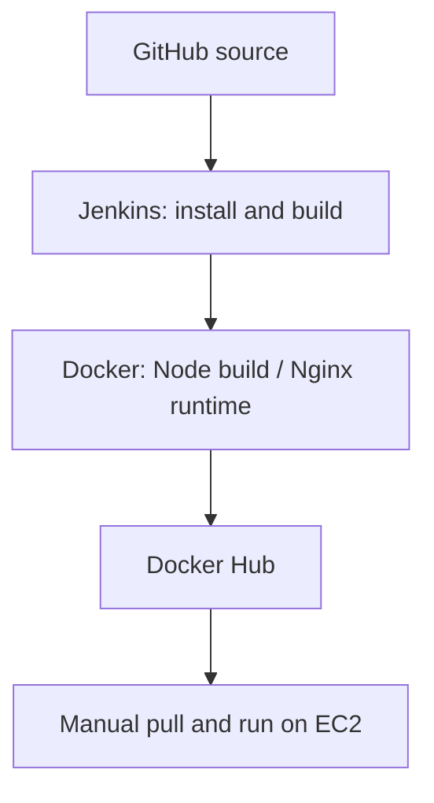

# FocusFlow

A React Pomodoro timer packaged with Docker and served by Nginx. This project demonstrates a Jenkins build-and-publish pipeline and a manual deployment path to an Ubuntu EC2 instance.

## What it demonstrates

- **Repeatable builds:** Jenkins installs locked dependencies, builds the frontend, builds a Docker image, and publishes it to Docker Hub.
- **Separate build and runtime environments:** Node.js builds the app; the final image contains Nginx and the generated static files.
- **Troubleshooting:** a custom Jenkins image supplies Node.js, npm and the Docker CLI to address missing build tools.
- **Deployment practice:** the published image can run locally or on an EC2 host with Docker.

The pipeline ends at Docker Hub. EC2 deployment is a separate manual step; this repository does not implement automatic deployment or rollback.

## Application features

Focus, short-break and long-break modes; configurable durations; start, pause and reset controls; session history and productivity statistics stored in the browser; audio and permission-based browser notifications.

Default durations are 25, 5 and 15 minutes, with a long break after four focus sessions. Browser storage is local to each browser; there is no backend or account synchronisation.

## Delivery path



## Run locally

Use a recent Node.js 22 release (22.12 or newer) and npm.

```sh
git clone https://github.com/techstar17/focusflow.git
cd focusflow
npm ci
npm run dev
```

Open the URL printed by Vite. Other commands:

| Command | Purpose |
| --- | --- |
| `npm run lint` | Run Oxlint |
| `npm run build` | Produce static files in `dist/` |
| `npm run preview` | Preview the production build locally |

## Run with Docker

With Docker installed and running:

```sh
docker build -t focusflow:local .
docker run --detach --name focusflow-demo --publish 127.0.0.1:3000:80 focusflow:local
```

Open http://localhost:3000. To remove this demo container:

```sh
docker stop focusflow-demo
docker rm focusflow-demo
```

## Jenkins and EC2

See [the deployment guide](docs/deployment.md) for the required Jenkins credentials, build stages, EC2 commands, and troubleshooting.

## Repository guide

| Path | Purpose |
| --- | --- |
| `src/App.jsx` | Timer, settings and session-history behaviour |
| `src/App.css`, `src/index.css` | App styling |
| `Dockerfile` | Multi-stage frontend build and Nginx runtime |
| `Dockerfile.jenkins` | Jenkins image with build tools |
| `Jenkinsfile` | Four-stage build-and-publish pipeline |
| `docs/deployment.md` | Setup, deployment and troubleshooting |

## Current scope

This is a learning and portfolio project. It has no automated application test suite, production monitoring, TLS configuration, or uptime guarantee. Notification support depends on browser permissions and secure-context rules. Jenkins job triggers and Docker daemon access must be configured outside the repository.

## Author

[Festus Oluwatunmise Onadeko](https://github.com/techstar17) — cloud and DevOps internship candidate, Abeokuta, Nigeria.
